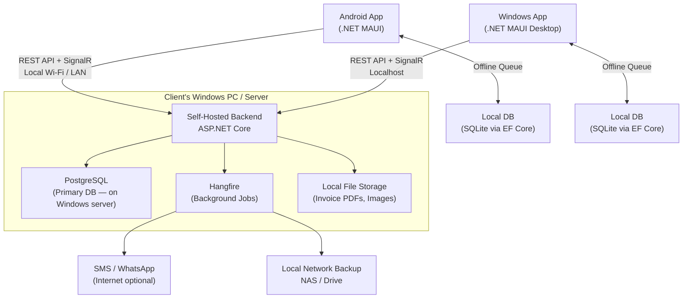
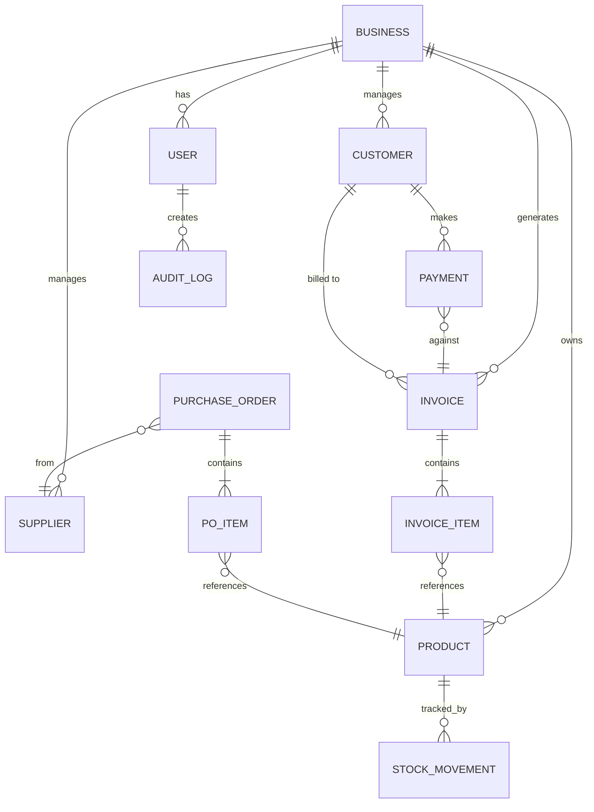
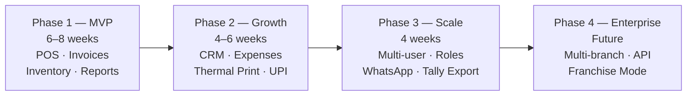

# 📋 BillMate — Product Requirements Document (PRD)
**Version:** 1.1  
**Date:** November 2026  
**Target Platforms:** Android & Windows (Desktop)  
**Target Market:** India 🇮🇳 (GST-compliant)  
**Deployment Model:** Self-hosted (on-premise / client's own server)  
**Target Users:** Retail shops, service providers, small-to-medium businesses

---

> [!IMPORTANT]
> BillMate is **self-hosted only** — each client installs and runs the entire stack on their own machine or local server. No cloud subscription required. Data never leaves the client's premises. The software is **India-first**, fully GST-compliant (CGST, SGST, IGST, Cess), with INR as the base currency and Indian regulatory formats baked in.

---

## 1. Product Overview

### 1.1 Vision
BillMate is a **cross-platform billing and business management solution** for small-to-medium retail shops, service centres, restaurants, clinics, and other businesses. It enables business owners to manage sales, inventory, customers, and finances from a single application — on both a Windows desktop and an Android device (phone/tablet), with real-time sync across devices.

### 1.2 Goals
- Replace paper-based / Excel-based billing workflows
- Support **offline-first** operations — works fully without internet, syncs across devices on local network
- Produce **GST-compliant invoices** (retail invoice, proforma, delivery challan, credit note)
- Support **GSTR-1, GSTR-3B** tax summary reports
- Be **self-hosted** — entire stack runs on the client's Windows PC or local server; no cloud dependency
- Be deployable as a **white-label product** per client (custom name, logo, colours)
- Scale from a solo proprietor to a small team of cashiers
- Support **UPI, cash, and card** payment modes with Indian payment norms

### 1.3 Non-Goals (v1.0)
- Cloud/SaaS hosting or internet-based sync (data stays on-premise)
- Multi-branch / franchise management (v2 roadmap)
- Restaurant Table & Kitchen Order Token (KOT) management (v2 roadmap)
- Pole / customer-facing external display & live NIC e-Way Bill API auto-generation (v2 roadmap)
- E-commerce / online storefront
- Payroll & HR management
- International tax regimes (VAT, GST-AU, etc.)

---

## 2. User Personas

| Persona | Role | Key Needs |
|---|---|---|
| **Shop Owner** | Admin | Full access — reports, settings, users |
| **Cashier / Billing Staff** | Operator | Create bills, accept payments, basic inventory view |
| **Accountant** | Finance | Reports, ledgers, expense tracking, tax summaries |
| **Customer** | End user | Receives digital/printed bills, loyalty points |

---

## 3. Core Feature Modules

### 3.1 🧾 Billing & Invoicing

#### 3.1.1 POS (Point of Sale) Screen
- Fast product search by name, barcode, or SKU
- Barcode scanner support (device camera or external USB/Bluetooth scanner)
- Cart management — add, edit, remove line items
- Apply discounts: flat (₹) or percentage (%) per item or on the total
- Apply taxes: GST (CGST + SGST / IGST), configurable tax slabs
- Multiple payment modes: Cash, UPI, Card (via integrated PG), Credit (against customer account)
- Split payment across modes
- Hold bill (park & resume) — multiple active holds simultaneously
- Quick product shortcuts / favourites panel
- Real-time sub-total, tax breakdown, and grand-total display
- *(v2 Roadmap)* Table / KOT (Kitchen Order Token) management for restaurants

#### 3.1.2 Invoice Generation
- **GST-compliant** invoice format — tax invoice, **Bill of Supply** (for Composite Scheme dealers), proforma, quotation, delivery challan, credit note
- Mandatory fields: Seller GSTIN, Buyer GSTIN (if B2B), place of supply, HSN/SAC codes
- **CGST + SGST** (intra-state) and **IGST** (inter-state) auto-applied based on seller & buyer state
- **Cess** support (e.g., tobacco, luxury goods)
- **Reverse charge mechanism (RCM)** flag per line item
- Auto-increment invoice numbering with custom prefixes (`INV-2026-0001`), reset per financial year (Apr–Mar)
- Bill-to / Ship-to address support
- **e-Way Bill** manual reference fields (e-Way Bill No. & Vehicle No. for goods > ₹50,000 in transit; live NIC API auto-generation in v2)
- Signature field (image upload)
- Invoice notes / terms & conditions section
- Invoice duplication / clone
- Invoice cancellation & credit note generation
- **Amounts in words** (Indian numbering system — lakhs, crores)

#### 3.1.3 Print, Hardware & Share
- Thermal printer (80mm / 58mm) support via ESC/POS protocol
- **Cash drawer kick** via RJ12 pulse command (`ESC p`) through connected thermal printer
- External **USB/Bluetooth barcode scanner** & Android camera scanning
- A4 / A5 PDF generation and print
- Share invoice via WhatsApp, SMS, or Email directly from app
- QR code on bill for payment (UPI deep link)

---

### 3.2 📦 Inventory Management

#### 3.2.1 Product Catalogue
- Product name, description, category, brand
- Multiple units of measurement (pcs, kg, litre, box, etc.)
- Base price, selling price, MRP
- Batch / expiry date tracking
- Serial number tracking (for electronics)
- Product images
- Variants (size, colour, weight)
- Low-stock threshold alerts

#### 3.2.2 Stock Operations
- Purchase order creation and receiving (GRN — Goods Receipt Note)
- Stock adjustment (add / remove with reason)
- Stock transfer between locations (v1: single location)
- Inventory audit / stock-take with discrepancy report

#### 3.2.3 Supplier Management
- Supplier name, contact, GSTIN, payment terms
- Purchase history per supplier
- Outstanding payables tracking

---

### 3.3 👥 Customer Management (CRM Lite)

- Customer profile: name, phone, email, address, GSTIN
- Purchase history timeline
- Outstanding credit / advance balance
- Loyalty points: earn on purchase, redeem at billing
- Customer-wise pricing tiers (retail / wholesale)
- Birthday / anniversary reminders
- Bulk SMS / WhatsApp campaigns to customer segments

---

### 3.4 💰 Payments & Accounts

#### 3.4.1 Payment Tracking
- Record inward payments against invoices
- Partial payments and payment schedules
- Advance / deposit collection
- Automatic due-date reminders to customers

#### 3.4.2 Expense Management
- Record business expenses with categories
- Attach receipt photo
- Link expenses to suppliers or projects

#### 3.4.3 Cash Drawer Management
- Cash register open/close with opening balance
- Day-end cash reconciliation
- Denominations count sheet

---

### 3.5 📊 Reports & Analytics

| Report | Description |
|---|---|
| **Sales Summary** | Daily / weekly / monthly / custom range |
| **Item-wise Sales** | Best sellers, slow movers |
| **GSTR-1 Report** | B2B / B2C invoice-wise tax summary (ready for CA filing) |
| **GSTR-3B Summary** | Tax liability by slab (5%, 12%, 18%, 28%) |
| **HSN/SAC Summary** | HSN-wise taxable value and tax (Annex to GSTR-1) |
| **Customer Ledger** | Per-customer balance & history |
| **Supplier Ledger** | Payables summary |
| **Inventory Valuation** | Current stock value at cost / MRP |
| **Profit & Loss (Gross)** | Revenue vs. cost of goods |
| **Expense Report** | Category-wise expense breakdown |
| **Payment Mode Summary** | Cash / UPI / Card split |
| **Day Book** | All transactions for the day |
| **Outstanding Receivables** | Aged debtors report (0–30, 31–60, 60+ days) |
| **Financial Year Summary** | April–March annual roll-up |

- Charts: bar, line, pie (built-in visualisations)
- Export: Excel (.xlsx), PDF, CSV
- Scheduled email reports (daily/weekly summary)

---

### 3.6 ⚙️ Settings & Configuration

#### Business Profile
- Business name, logo, address, GSTIN, PAN, phone, email, website
- Multiple business types (retail, service, restaurant toggle)
- Financial year configuration
- Currency & locale

#### Tax Configuration
- Define GST slabs: **0%, 5%, 12%, 18%, 28%** + Cess %
- CGST/SGST split (intra-state) and IGST (inter-state) auto-computed from state codes
- **HSN/SAC code master** with auto-suggested tax rates
- Composite scheme support (1% / 5% flat, no ITC)
- **Reverse Charge Mechanism (RCM)** configuration per product
- Financial year: **April–March** (Indian FY)
- State list (all 28 states + 8 UTs with state codes for place-of-supply logic)

#### User & Role Management
- Role-based access control (Admin, Manager, Cashier, Accountant)
- Per-role feature permissions
- Activity log / audit trail
- PIN-based quick login for cashiers

#### Integrations
- **Tally Prime / Tally ERP 9** export (XML / JSON format)
- **UPI QR** code on invoice (static VPA-based)
- **Razorpay / PhonePe PG** (optional card/UPI PG — client's own account credentials entered in settings)
- **Fast2SMS / Textlocal** (Indian SMS gateways) for invoice & payment reminders
- **WhatsApp Business API** (Meta Cloud API) for sharing invoices
- **Local network backup** to NAS or mapped drive (no cloud required)
- **Google Drive backup** (optional, client opt-in — see Section 3.9)

---

### 3.9 ☁️ Google Drive Backup & Disaster Recovery

> [!IMPORTANT]
> **Data sovereignty**: Backups go to the **shop owner's own Google account** (15 GB free). You (the developer/vendor) have zero access to their data. Each client manages their own backup independently.

#### Backup Strategy (Layered)

| Layer | Method | Frequency | Storage |
|---|---|---|---|
| **Layer 1** | Local `pg_dump` → client's HDD / NAS | Nightly (configurable) | Local — free |
| **Layer 2** | Google Drive upload of compressed dump | Nightly / every 6 hrs | Client's Drive — 15 GB free |
| **Layer 3** | Google Drive version history | Automatic by Google | 30 days Drive history |

#### How Backup Works (Automatic)
1. **Hangfire** triggers a scheduled job (default: nightly at 11 PM)
2. `pg_dump` creates a compressed `.dump.gz` snapshot of PostgreSQL (typical size: 5–50 MB)
3. Integrity verified with `pg_restore --list` before marking success
4. File uploaded to Google Drive folder: `BillMate Backups / [BusinessName] / billmate_YYYYMMDD.dump.gz`
5. Files older than **30 days** are auto-deleted from Drive (keeps last 30 backups)
6. Result logged to `backup_logs` table

#### How Restore Works (3-Click Wizard)
1. Shop owner opens **Restore Wizard** in Settings → app lists all Drive backups with date and size
2. Select a backup date → app downloads the `.dump.gz` with a progress bar
3. Click **Restore** → app stops the service, drops DB, runs `pg_restore`, restarts service
4. ✅ All data (invoices, inventory, customers, settings) restored exactly as of that backup

#### Maximum Data Loss (RPO)
| Backup Frequency | Worst-Case Data Loss |
|---|---|
| Nightly | Up to 1 day |
| Every 6 hours | Up to 6 hours |
| Every 1 hour *(recommended for busy shops)* | Up to 1 hour |

> [!TIP]
> Android devices do **not** need restore — they are clients, not data stores. Once the Windows server is restored, all Android devices reconnect automatically with no action required.

---

### 3.7 🔄 Sync & Offline Mode

- **Offline-first**: all core operations (billing, inventory) work without internet
- Local SQLite database on each device; syncs to the **self-hosted ASP.NET Core server on the local network** (Wi-Fi / LAN)
- Android devices (phone/tablet) connect to the Windows server over local Wi-Fi
- No internet required for sync — works entirely on the shop's LAN
- Conflict resolution: last-write-wins with conflict log visible to admin
- Multi-device: Windows desktop (server + app) + Android tablet/phone on the same LAN
- **Internet only needed for**: WhatsApp/SMS sending, optional Google Drive backup, payment gateway (if used)
- Background sync with in-app alerts on sync failures

---

### 3.8 🔒 Data & Security

- End-to-end encrypted cloud backup
- Local database encryption (SQLCipher)
- Biometric login (fingerprint) on Android
- PIN / password login on Windows
- Auto-logout after configurable idle timeout
- Role-based data visibility (cashier cannot see profit margins)
- GDPR / data privacy controls (customer data export & delete)

---

## 4. UX & Design Principles

### 4.1 Look & Feel
- **Material Design 3** (MD3) on Android
- **Fluent Design** on Windows
- Light and Dark theme support
- Accent colour customisable per client (white-label)
- Custom logo on splash screen and invoice header

### 4.2 Navigation Patterns
```
Sidebar (Windows / Tablet)         Bottom Nav (Phone)
├── Dashboard (Home)               Dashboard | Bills | Inventory
├── New Bill (POS)                 Customers | More
├── Invoices
├── Inventory
├── Customers
├── Suppliers
├── Payments & Expenses
├── Reports
└── Settings
```

### 4.3 Accessibility
- Minimum tap target 48×48dp
- Screen-reader labels (TalkBack / Narrator)
- Font size scaling
- High-contrast mode

### 4.4 Localisation
- **Language: English + Hindi** (default); regional Indian languages via `.resx` files (Marathi, Tamil, Telugu, Gujarati — roadmap)
- **Currency: INR ₹** (hardcoded as base; Indian number formatting — lakhs/crores)
- Date format: `DD/MM/YYYY` (Indian standard)
- **Indian financial year**: April–March (all reports, numbering, audit logs respect this)
- State & district master data (all Indian states + UTs)

---

## 5. Tech Stack

### 5.1 Architecture Overview



> [!NOTE]
> The **Windows PC acts as both the server and a client**. The ASP.NET Core backend runs as a **Windows Service** in the background — the shop owner installs it once and it auto-starts with Windows. Android devices on the same Wi-Fi connect to it via local IP.

### 5.2 Frontend — .NET MAUI (Cross-Platform)

| Concern | Package / Tool |
|---|---|
| Framework | **.NET MAUI 9** (single C# codebase → Android + Windows) |
| Architecture | **MVVM** via `CommunityToolkit.Mvvm` |
| Local Database | **SQLite** via `sqlite-net-pcl` or EF Core SQLite |
| HTTP Client | `HttpClient` + `Refit` (typed API client) |
| Real-time Sync | **SignalR Client** (Microsoft.AspNetCore.SignalR.Client) |
| PDF Generation | **QuestPDF** (C# fluent PDF builder) |
| Thermal Print | **ESCPOS.NET** (ESC/POS for 80mm/58mm printers) |
| Barcode Scan | **ZXing.Net.MAUI** |
| Charts | **LiveCharts2** (MAUI binding) |
| Auth | `SecureStorage` (MAUI) + biometrics (`Plugin.Fingerprint`) |
| Localisation | .NET `.resx` resource files |
| UI Components | **.NET MAUI** + `CommunityToolkit.Maui` controls |

> [!TIP]
> Since both frontend and backend are **C#**, you can place **shared domain models, DTOs, enums, and validators** in a common `.NET Class Library` project — eliminating duplication entirely.

### 5.3 Backend — ASP.NET Core

| Concern | Package / Tool |
|---|---|
| Framework | **ASP.NET Core 9** (Minimal API) |
| ORM | **Entity Framework Core 9** + Npgsql provider |
| Primary DB | **PostgreSQL 16** |
| Background Jobs | **Hangfire** (recurring reports, SMS, reminders) |
| Real-time | **SignalR** (multi-device live sync on LAN) |
| Auth | **JWT** (access + refresh tokens) |
| Validation | **FluentValidation** |
| PDF Reports | **QuestPDF** (shared with frontend lib) |
| File Storage | Local filesystem (Windows path, configurable) |
| API Docs | **Swagger / Scalar** (OpenAPI) |
| Hosting | **Windows Service** (`UseWindowsService()`) |
| Logging | **Serilog** → local rolling file + optional Seq UI |
| Testing | **xUnit** + **Testcontainers** (PostgreSQL in Docker for tests) |

### 5.4 Solution Structure

```
BillMate.sln
├── src/
│   ├── BillMate.Domain/          ← Entities, enums, value objects
│   ├── BillMate.Application/     ← CQRS handlers, DTOs, interfaces
│   ├── BillMate.Infrastructure/  ← EF Core, Hangfire, SMS, file storage
│   ├── BillMate.Api/             ← ASP.NET Core Minimal API + SignalR
│   └── BillMate.App/             ← .NET MAUI app (Android + Windows)
│       ├── Platforms/Android/
│       ├── Platforms/Windows/
│       └── Shared ViewModels, Pages, Services
├── tests/
│   ├── BillMate.Domain.Tests/
│   ├── BillMate.Application.Tests/
│   └── BillMate.Api.Tests/
└── installer/
    └── BillMate.Setup/           ← WiX / Inno Setup installer for Windows
```

### 5.5 Deployment & Distribution

| Concern | Tool |
|---|---|
| **Windows Server Install** | **Inno Setup** `.exe` installer — installs PostgreSQL, ASP.NET Core runtime, app, registers Windows Service |
| **Windows Client App** | Bundled in same installer; launches MAUI desktop app |
| **Android App** | APK sideload (direct install) **or** private Google Play track |
| **Updates** | In-app update checker → downloads new installer from a local update server or USB/LAN share |
| **Database Migrations** | EF Core migrations run automatically on service start |
| **Backup** | Scheduled `pg_dump` via Hangfire → saves to local folder / NAS |

### 5.6 White-Label Configuration

```json
// client_config.json (bundled at build / editable post-install)
{
  "BusinessName": "Sharma General Store",
  "AppTitle": "Sharma Billing",
  "LogoPath": "Assets/logo.png",
  "PrimaryColor": "#1565C0",
  "AccentColor": "#FF6F00",
  "InvoicePrefix": "SGS",
  "GSTINDefault": "27AAAAA0000A1Z5",
  "State": "Maharashtra",
  "StateCode": "27",
  "SupportPhone": "98XXXXXXXX"
}
```

Each client gets:
- Their own **installer** with their branding baked in
- Custom invoice header/footer template
- Pre-filled business details on first launch
- **All data stays on their machine** — no other client's data ever mingles

---

## 6. Data Model (High-Level ERD)



---

### 7. Offline Sync Strategy

| Scenario | Behaviour |
|---|---|
| **Windows PC (server) offline** | Bill saved locally on Android; synced when server back on LAN |
| **Android device offline (no Wi-Fi)** | Bill saved to local SQLite; synced on reconnect to shop Wi-Fi |
| **Two devices bill simultaneously offline** | Conflict resolved on sync; admin notified in-app |
| **Inventory updated on both devices offline** | Merge by operation log (not snapshot diff) |
| **Sync failure** | Retry with exponential backoff; persistent alert in-app |
| **Data loss risk** | Local SQLite WAL + nightly `pg_dump` to local backup folder |
| **Power cut / crash during billing** | SQLite transaction rollback ensures no partial bills |

---

## 8. Security Requirements

- All API traffic over **HTTPS** (TLS 1.3 with pinned local CA cert on LAN)
- Passwords & cashier PINs hashed with **BCrypt** (cost factor 12)
- JWT expiry: access token 15 min, refresh token 30 days
- Rate limiting on auth endpoints (10 req/min per IP)
- SQL injection prevention via **EF Core** parameterised queries
- Local storage encryption: **SQLCipher** (Android) & **Windows DPAPI**
- OWASP Mobile Top 10 mitigations in .NET MAUI app
- Audit log for all create/update/delete/cancel/restore operations

---

## 9. Release Phases



### Phase 1 MVP Scope (Completed ✅)
- [x] POS billing screen with product search & rapid barcode scanner auto-add
- [x] Product images attachment & visual catalog cards
- [x] Basic invoice generation (PDF + 80mm/58mm thermal print & cash drawer pulse)
- [x] Product catalogue & opening stock
- [x] Inventory tracking with low stock alerts & quick ± adjustments
- [x] Daily sales report & Day Book cash reconciliation
- [x] Quick Cash Tender buttons (Exact, ₹100, ₹200, ₹500, ₹2000) & change calculator
- [x] Multi-process supervisor (auto-starts PostgreSQL 16 + API sidecar)
- [x] High-contrast AAA typography & always-visible locked sidebar

### Phase 2 (Completed ✅)
- [x] Customer management + credit ledger
- [x] Expense tracking & petty cash categories
- [x] Thermal printer integration (ESC/POS)
- [x] UPI, Card, Cash & Credit payment modes
- [x] Multi-device sync (SignalR + SQLite WAL offline queue)
- [x] Multi-user roles & cashier PIN quick switch (PIN: 1234)
- [x] GST reports (GSTR-1 and GSTR-3B tax summaries ready for CA)
- [x] Android APK build script (`scripts/build-android.ps1`) & Wi-Fi LAN IP server configuration

### Phase 3 (Roadmap v2.0)
- [ ] WhatsApp invoice sharing
- [ ] Restaurant KOT & Table management
- [ ] Live NIC e-Way Bill API integration
- [ ] External Pole / Customer VFD secondary display
- [ ] Tally XML export format

---

## 10. Success Metrics (KPIs)

| Metric | Target (6 months post-launch) |
|---|---|
| Bills created per active client / day | ≥ 50 |
| App crash rate | < 0.5% |
| Offline bill sync success rate | ≥ 99.9% |
| Invoice generation time | < 3 seconds |
| NPS (client satisfaction) | ≥ 50 |
| Onboarding time (new shop) | < 30 minutes |

---

## 11. Resolved Scope & Architecture Decisions (v1.0)

> [!IMPORTANT]
> All initial scoping and architecture decisions have been finalised and locked in for **v1.0**:

| Decision Area | Finalised Choice |
|---|---|
| **SFDC Focus** | Architectural Pillars (**S**ecurity, **F**ault Tolerance, **D**ata Integrity, **C**oncurrency) — no Salesforce CRM connector |
| **Server Database** | **PostgreSQL 16** bundled silently inside the **Inno Setup** `.exe` installer |
| **Restaurant / KOT Mode** | **Deferred to v2.0** — v1.0 focuses on Retail & Service shops |
| **POS Hardware (v1.0)** | **Thermal Printer (ESC/POS)** + **Barcode Scanner** + **RJ12 Cash Drawer kick** (Pole Customer Display deferred to v2.0) |
| **GST Edge Cases (v1.0)** | **Composite Scheme** (1%/5% flat, Bill of Supply) included in v1.0; manual **e-Way Bill / Vehicle No.** fields on invoice (live NIC API deferred to v2.0) |
| **Android Form Factor** | **Both Phone & Tablet** — adaptive .NET MAUI layout (bottom-nav/compact POS on phone; split-pane sidebar POS on tablet) |
| **Distribution** | **Direct distribution** — white-labeled **Inno Setup `.exe`** (Windows) + signed **`.apk`** (Android) delivered via USB or private client download link |

---

## 12. Competitive Benchmarks

| Feature | BillMate | Vyapar | Busy Accounting | Marg ERP |
|---|---|---|---|---|
| Cross-platform (Android + Windows) | ✅ | ✅ | ✅ | ✅ |
| Self-hosted / on-premise | ✅ | ❌ | ✅ | ✅ |
| Offline-first | ✅ | ✅ | ✅ | ✅ |
| White-label | ✅ | ❌ | ❌ | ❌ |
| GST compliant (CGST/SGST/IGST) | ✅ | ✅ | ✅ | ✅ |
| GSTR-1 / GSTR-3B reports | ✅ | ✅ | ✅ | ✅ |
| Thermal print (ESC/POS) | ✅ | ✅ | ✅ | ✅ |
| Built on .NET (easy to customise) | ✅ | ❌ | ❌ | ❌ |
| One-time licence (no subscription) | ✅ | ❌ | ✅ | ✅ |

---

*Document Owner: Product Team | Last Updated: November 2026 (v1.1 — Self-hosted, India, .NET MAUI + ASP.NET Core)*
