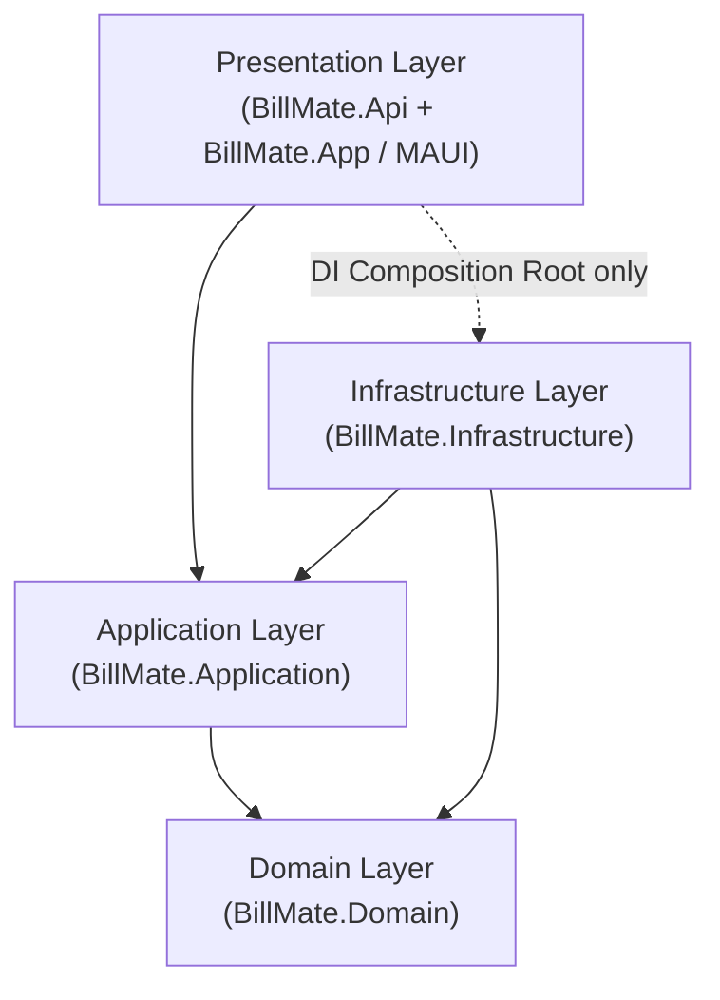
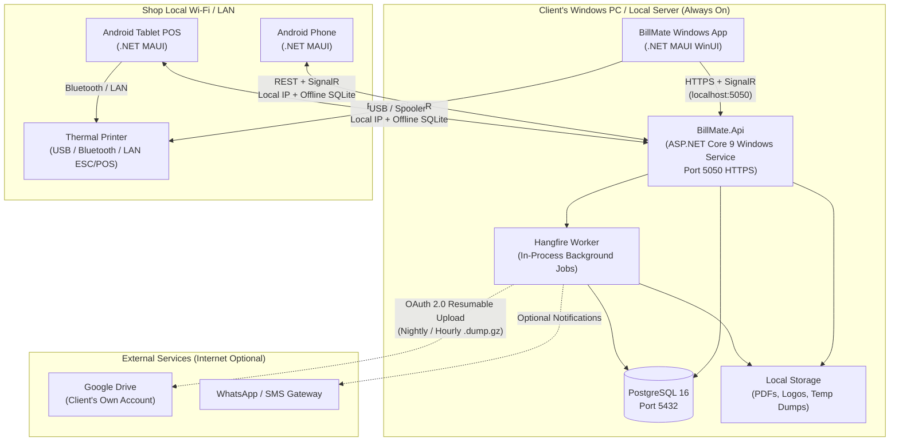
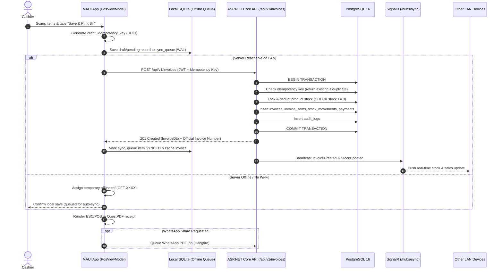

# 🏗️ BillMate — Software Requirements Document (SRD)
**Version:** 1.0  
**Date:** November 2026  
**Scope:** Self-Hosted, India-First Billing & Inventory Platform (Android + Windows)  
**Target Audience:** Software Architects, .NET Backend & MAUI Engineers, QA Engineers, DevOps  
**Reference:** [BillMate PRD v1.1](./BillMate_PRD.md)

---

## 1. System Overview

### 1.1 Purpose
This Software Requirements Document (SRD) translates the business and functional requirements defined in the **BillMate PRD** into an implementable, production-grade technical blueprint using the **.NET 9 ecosystem** (**.NET MAUI** + **ASP.NET Core 9** + **PostgreSQL 16**).

### 1.2 Technical Design Goals
- **Maintainability:** Strict **Clean Architecture** separation with shared C# domain contracts between client and server.
- **On-Premise Simplicity:** Single-installer Windows deployment (`Inno Setup`) running PostgreSQL and an ASP.NET Core Windows Service without cloud dependencies.
- **Offline Resilience:** Full local SQLite persistence on client devices with idempotent LAN synchronization.
- **SFDC Rigor:** Built from the ground up around **S**ecurity, **F**ault Tolerance, **D**ata Integrity, and **C**oncurrency.
- **White-Label Ready:** Tenant configuration, branding, and Indian GST rules (CGST/SGST/IGST/Cess, HSN/SAC, April–March FY) isolated cleanly in configuration and domain services.

### 1.3 System Boundaries

| Boundary | Inside System | Outside System |
|---|---|---|
| **Client Apps** | .NET MAUI app (Windows Desktop + Android Phone/Tablet), local SQLite cache | OS printer spooler, Android camera hardware |
| **Local Server** | ASP.NET Core 9 Minimal API, SignalR Hub, Hangfire worker, QuestPDF, PostgreSQL 16 | Windows Service Control Manager, LAN Wi-Fi Router |
| **External Integrations (Optional)** | OAuth/REST adapters for Google Drive, WhatsApp Cloud API, SMS, Payment Gateways | Google Drive servers, Meta servers, Razorpay/PhonePe, Tally Prime |

### 1.4 Finalised v1.0 Scope & Hardware/Distribution Constraints
- **Target Vertical (v1.0):** Retail & Service shops (Restaurant Table/KOT mode deferred to v2.0).
- **GST Edge Cases (v1.0):** Supports **Composite Scheme** (`BILL_OF_SUPPLY`, 1%/5% flat turnover reporting, no ITC) and manual **e-Way Bill / Vehicle No.** fields on invoices (live NIC e-Way Bill API deferred to v2.0).
- **POS Hardware (v1.0):** Thermal printer (`ESC/POS` 58mm/80mm), **RJ12 Cash Drawer kick** (`ESC p` pulse via printer), and USB/Bluetooth/Camera barcode scanning (Pole Customer Display deferred to v2.0).
- **MAUI Form Factors:** Adaptive layouts for **Windows Desktop**, **Android Tablet** (split-pane POS), and **Android Phone** (compact bottom-nav POS).
- **Packaging & Distribution:** Silent **PostgreSQL 16** + Windows Service + MAUI desktop bundled into a white-labeled **Inno Setup `.exe`**, paired with a signed white-labeled Android **`.apk`** distributed directly via USB or private client download link.

---

## 2. System Architecture

### 2.1 Architectural Pattern — Clean Architecture

BillMate follows **Clean Architecture** with strict inward dependency flow: outer layers depend on inner layers; inner layers never reference outer layers.



#### Layer Responsibilities

| Layer | Project | Contents |
|---|---|---|
| **Domain** | `BillMate.Domain` | Entities, Value Objects (`Money`, `Gstin`, `TaxBreakdown`), Aggregates (`Invoice`, `PurchaseOrder`), Domain Events, Domain Exceptions, Enums. Zero external NuGet dependencies. |
| **Application** | `BillMate.Application` | CQRS Commands & Queries (`MediatR`), DTOs, Port Interfaces (`IApplicationDbContext`, `IGoogleDriveService`, `IThermalPrinter`, `ICurrentUserService`), `FluentValidation` validators, Pipeline Behaviors (logging, validation, transactions). |
| **Infrastructure** | `BillMate.Infrastructure` | `EF Core 9` + `Npgsql` DbContext & migrations, `Hangfire` recurring/background jobs, `Google.Apis.Drive.v3` adapter, `QuestPDF` invoice generator, `ESCPOS.NET` thermal print adapter, SMS/WhatsApp HTTP clients, `BCrypt.Net` hashing. |
| **Presentation (API)** | `BillMate.Api` | ASP.NET Core 9 Minimal API endpoints, JWT & PIN Auth middleware, `SignalR` `/hubs/sync`, Global Exception Handler, Health Checks, `Serilog` + `WindowsService` host. |
| **Presentation (App)** | `BillMate.App` | `.NET MAUI 9` app for Android & Windows, `CommunityToolkit.Mvvm` ViewModels, XAML Views, `Refit` API client, `Polly` resilience policies, local `SQLite` offline queue & cache, `ZXing.Net.MAUI` scanner. |

---

### 2.2 Solution Structure

```text
BillMate.sln
├── src/
│   ├── BillMate.Domain/
│   │   ├── Common/               # BaseEntity, AuditableEntity, IDomainEvent
│   │   ├── Entities/             # Business, Invoice, Product, Customer, etc.
│   │   ├── ValueObjects/         # Gstin, Money, TaxRate, Address
│   │   ├── Enums/                # InvoiceStatus, PaymentMode, RoleType, etc.
│   │   └── Exceptions/           # DomainException, InsufficientStockException
│   ├── BillMate.Application/
│   │   ├── Common/
│   │   │   ├── Behaviors/        # ValidationBehavior, TransactionBehavior, LoggingBehavior
│   │   │   └── Interfaces/       # IApplicationDbContext, IBackupService, etc.
│   │   ├── Features/
│   │   │   ├── Auth/
│   │   │   ├── Invoices/         # CreateInvoiceCommand, CancelInvoiceCommand, GetInvoiceQuery
│   │   │   ├── Products/
│   │   │   ├── Customers/
│   │   │   ├── PurchaseOrders/
│   │   │   ├── Reports/          # Gstr1Query, Gstr3bQuery, DayBookQuery
│   │   │   └── Backup/
│   │   └── Contracts/            # Shared DTOs & Sync payloads
│   ├── BillMate.Infrastructure/
│   │   ├── Persistence/          # AppDbContext, Configurations/, Migrations/
│   │   ├── Services/             # GoogleDriveBackupService, PgDumpRunner, QuestPdfService
│   │   ├── Jobs/                 # NightlyBackupJob, DueReminderJob
│   │   └── DependencyInjection.cs
│   ├── BillMate.Api/
│   │   ├── Endpoints/            # Minimal API route groups (v1)
│   │   ├── Hubs/                 # SyncHub.cs
│   │   ├── Middleware/           # GlobalExceptionMiddleware, TenantResolutionMiddleware
│   │   └── Program.cs            # UseWindowsService(), HealthChecks, Serilog
│   └── BillMate.App/             # .NET MAUI 9 (Single Project)
│       ├── Platforms/
│       │   ├── Android/          # Permissions, Biometric, Bluetooth/USB print
│       │   └── Windows/          # WinUI windowing, USB/Spooler print, DPAPI
│       ├── LocalDb/              # SQLite entities, SyncQueueRepository
│       ├── Services/             # Refit clients, SyncEngine, SignalRClientService
│       ├── ViewModels/           # PosViewModel, InventoryViewModel, RestoreViewModel
│       └── Views/                # XAML pages (Responsive Phone / Tablet / Desktop)
├── tests/
│   ├── BillMate.Domain.Tests/
│   ├── BillMate.Application.Tests/
│   └── BillMate.Api.Integration.Tests/  # xUnit + Testcontainers (PostgreSQL)
└── installer/
    └── BillMate.Setup/           # Inno Setup script (.iss) + PostgreSQL silent bundle
```

---

### 2.3 Deployment Architecture



---

### 2.4 Data Flow — Billing Transaction



---

## 3. Database Schema (PostgreSQL 16)

> [!IMPORTANT]
> **Schema Conventions:**
> - Primary keys use `UUID` (`gen_random_uuid()` via `pgcrypto` or `uuid-ossp`).
> - All tenant-scoped tables carry `business_id UUID NOT NULL` for isolation.
> - Monetary columns strictly use `NUMERIC(12,2)`; quantities use `NUMERIC(10,3)` (supports fractional units like `1.250 kg`).
> - Timestamps use `TIMESTAMPTZ` stored in UTC.
> - Financial tables implement **soft deletes** (`is_deleted`, `deleted_at`) and **never** use cascading hard deletes.

### 3.1 Configuration & Auth Tables

```sql
CREATE EXTENSION IF NOT EXISTS "pgcrypto";

-- 1. Businesses (Tenant Root)
CREATE TABLE businesses (
    id                  UUID PRIMARY KEY DEFAULT gen_random_uuid(),
    name                VARCHAR(200) NOT NULL,
    legal_name          VARCHAR(200),
    gstin               VARCHAR(15),
    pan                 VARCHAR(10),
    business_type       VARCHAR(30) NOT NULL DEFAULT 'RETAIL' CHECK (business_type IN ('RETAIL', 'SERVICE', 'RESTAURANT', 'WHOLESALE')),
    is_composition      BOOLEAN NOT NULL DEFAULT FALSE,
    address_line1       VARCHAR(250) NOT NULL,
    address_line2       VARCHAR(250),
    city                VARCHAR(100) NOT NULL,
    state               VARCHAR(100) NOT NULL,
    state_code          CHAR(2) NOT NULL,
    pincode             VARCHAR(10) NOT NULL,
    phone               VARCHAR(20) NOT NULL,
    email               VARCHAR(150),
    logo_path           VARCHAR(500),
    signature_path      VARCHAR(500),
    financial_year_start_month SMALLINT NOT NULL DEFAULT 4 CHECK (financial_year_start_month BETWEEN 1 AND 12),
    invoice_prefix      VARCHAR(20) NOT NULL DEFAULT 'INV',
    currency_code       CHAR(3) NOT NULL DEFAULT 'INR',
    is_deleted          BOOLEAN NOT NULL DEFAULT FALSE,
    deleted_at          TIMESTAMPTZ,
    created_at          TIMESTAMPTZ NOT NULL DEFAULT NOW(),
    updated_at          TIMESTAMPTZ NOT NULL DEFAULT NOW()
);

-- 2. Roles
CREATE TABLE roles (
    id                  UUID PRIMARY KEY DEFAULT gen_random_uuid(),
    business_id         UUID NOT NULL REFERENCES businesses(id) ON DELETE RESTRICT,
    name                VARCHAR(50) NOT NULL, -- ADMIN, MANAGER, CASHIER, ACCOUNTANT
    description         VARCHAR(250),
    is_system_role      BOOLEAN NOT NULL DEFAULT FALSE,
    is_deleted          BOOLEAN NOT NULL DEFAULT FALSE,
    deleted_at          TIMESTAMPTZ,
    created_at          TIMESTAMPTZ NOT NULL DEFAULT NOW(),
    updated_at          TIMESTAMPTZ NOT NULL DEFAULT NOW(),
    UNIQUE (business_id, name)
);

-- 3. Role Permissions
CREATE TABLE role_permissions (
    id                  UUID PRIMARY KEY DEFAULT gen_random_uuid(),
    business_id         UUID NOT NULL REFERENCES businesses(id) ON DELETE RESTRICT,
    role_id             UUID NOT NULL REFERENCES roles(id) ON DELETE CASCADE,
    permission_key      VARCHAR(100) NOT NULL, -- e.g. 'invoices.create', 'reports.gst'
    is_deleted          BOOLEAN NOT NULL DEFAULT FALSE,
    deleted_at          TIMESTAMPTZ,
    created_at          TIMESTAMPTZ NOT NULL DEFAULT NOW(),
    updated_at          TIMESTAMPTZ NOT NULL DEFAULT NOW(),
    UNIQUE (role_id, permission_key)
);

-- 4. Users
CREATE TABLE users (
    id                  UUID PRIMARY KEY DEFAULT gen_random_uuid(),
    business_id         UUID NOT NULL REFERENCES businesses(id) ON DELETE RESTRICT,
    role_id             UUID NOT NULL REFERENCES roles(id) ON DELETE RESTRICT,
    full_name           VARCHAR(150) NOT NULL,
    email               VARCHAR(150) NOT NULL,
    phone               VARCHAR(20),
    password_hash       VARCHAR(255) NOT NULL, -- BCrypt cost 12
    pin_hash            VARCHAR(255),          -- BCrypt for 4-6 digit quick POS login
    is_active           BOOLEAN NOT NULL DEFAULT TRUE,
    last_login_at       TIMESTAMPTZ,
    is_deleted          BOOLEAN NOT NULL DEFAULT FALSE,
    deleted_at          TIMESTAMPTZ,
    created_at          TIMESTAMPTZ NOT NULL DEFAULT NOW(),
    updated_at          TIMESTAMPTZ NOT NULL DEFAULT NOW(),
    UNIQUE (business_id, email)
);

-- 5. Refresh Tokens
CREATE TABLE refresh_tokens (
    id                  UUID PRIMARY KEY DEFAULT gen_random_uuid(),
    business_id         UUID NOT NULL REFERENCES businesses(id) ON DELETE RESTRICT,
    user_id             UUID NOT NULL REFERENCES users(id) ON DELETE CASCADE,
    device_id           UUID,
    token_hash          VARCHAR(255) NOT NULL UNIQUE,
    expires_at          TIMESTAMPTZ NOT NULL,
    revoked_at          TIMESTAMPTZ,
    replaced_by_token   VARCHAR(255),
    is_deleted          BOOLEAN NOT NULL DEFAULT FALSE,
    deleted_at          TIMESTAMPTZ,
    created_at          TIMESTAMPTZ NOT NULL DEFAULT NOW(),
    updated_at          TIMESTAMPTZ NOT NULL DEFAULT NOW()
);

-- 6. Audit Logs
CREATE TABLE audit_logs (
    id                  UUID PRIMARY KEY DEFAULT gen_random_uuid(),
    business_id         UUID NOT NULL REFERENCES businesses(id) ON DELETE RESTRICT,
    user_id             UUID REFERENCES users(id) ON DELETE SET NULL,
    device_id           UUID,
    entity_name         VARCHAR(100) NOT NULL,
    entity_id           UUID NOT NULL,
    action              VARCHAR(20) NOT NULL CHECK (action IN ('CREATE', 'UPDATE', 'DELETE', 'CANCEL', 'RESTORE')),
    old_values          JSONB,
    new_values          JSONB,
    ip_address          VARCHAR(45),
    is_deleted          BOOLEAN NOT NULL DEFAULT FALSE,
    deleted_at          TIMESTAMPTZ,
    created_at          TIMESTAMPTZ NOT NULL DEFAULT NOW(),
    updated_at          TIMESTAMPTZ NOT NULL DEFAULT NOW()
);
```

### 3.2 Tax & Catalogue Tables

```sql
-- 7. Tax Slabs
CREATE TABLE tax_slabs (
    id                  UUID PRIMARY KEY DEFAULT gen_random_uuid(),
    business_id         UUID NOT NULL REFERENCES businesses(id) ON DELETE RESTRICT,
    name                VARCHAR(50) NOT NULL, -- e.g. 'GST 18%', 'Exempt 0%'
    total_rate          NUMERIC(5,2) NOT NULL CHECK (total_rate >= 0),
    cgst_rate           NUMERIC(5,2) NOT NULL CHECK (cgst_rate >= 0),
    sgst_rate           NUMERIC(5,2) NOT NULL CHECK (sgst_rate >= 0),
    igst_rate           NUMERIC(5,2) NOT NULL CHECK (igst_rate >= 0),
    cess_rate           NUMERIC(5,2) NOT NULL DEFAULT 0.00 CHECK (cess_rate >= 0),
    is_default          BOOLEAN NOT NULL DEFAULT FALSE,
    is_deleted          BOOLEAN NOT NULL DEFAULT FALSE,
    deleted_at          TIMESTAMPTZ,
    created_at          TIMESTAMPTZ NOT NULL DEFAULT NOW(),
    updated_at          TIMESTAMPTZ NOT NULL DEFAULT NOW()
);

-- 8. HSN / SAC Codes Master
CREATE TABLE hsn_sac_codes (
    id                  UUID PRIMARY KEY DEFAULT gen_random_uuid(),
    business_id         UUID NOT NULL REFERENCES businesses(id) ON DELETE RESTRICT,
    code                VARCHAR(10) NOT NULL,
    code_type           CHAR(3) NOT NULL CHECK (code_type IN ('HSN', 'SAC')),
    description         VARCHAR(300) NOT NULL,
    default_tax_slab_id UUID REFERENCES tax_slabs(id) ON DELETE SET NULL,
    is_deleted          BOOLEAN NOT NULL DEFAULT FALSE,
    deleted_at          TIMESTAMPTZ,
    created_at          TIMESTAMPTZ NOT NULL DEFAULT NOW(),
    updated_at          TIMESTAMPTZ NOT NULL DEFAULT NOW(),
    UNIQUE (business_id, code)
);

-- 9. Categories (Hierarchical)
CREATE TABLE categories (
    id                  UUID PRIMARY KEY DEFAULT gen_random_uuid(),
    business_id         UUID NOT NULL REFERENCES businesses(id) ON DELETE RESTRICT,
    parent_id           UUID REFERENCES categories(id) ON DELETE SET NULL,
    name                VARCHAR(120) NOT NULL,
    sort_order          INT NOT NULL DEFAULT 0,
    is_deleted          BOOLEAN NOT NULL DEFAULT FALSE,
    deleted_at          TIMESTAMPTZ,
    created_at          TIMESTAMPTZ NOT NULL DEFAULT NOW(),
    updated_at          TIMESTAMPTZ NOT NULL DEFAULT NOW()
);

-- 10. Products
CREATE TABLE products (
    id                  UUID PRIMARY KEY DEFAULT gen_random_uuid(),
    business_id         UUID NOT NULL REFERENCES businesses(id) ON DELETE RESTRICT,
    category_id         UUID REFERENCES categories(id) ON DELETE SET NULL,
    tax_slab_id         UUID NOT NULL REFERENCES tax_slabs(id) ON DELETE RESTRICT,
    hsn_sac_code        VARCHAR(10),
    sku                 VARCHAR(80) NOT NULL,
    barcode             VARCHAR(80),
    name                VARCHAR(200) NOT NULL,
    description         TEXT,
    brand               VARCHAR(100),
    unit                VARCHAR(20) NOT NULL DEFAULT 'PCS', -- PCS, KG, LTR, BOX
    is_service          BOOLEAN NOT NULL DEFAULT FALSE,
    is_tax_inclusive    BOOLEAN NOT NULL DEFAULT TRUE,
    is_rcm_applicable   BOOLEAN NOT NULL DEFAULT FALSE,
    purchase_price      NUMERIC(12,2) NOT NULL DEFAULT 0.00 CHECK (purchase_price >= 0),
    selling_price       NUMERIC(12,2) NOT NULL CHECK (selling_price >= 0),
    mrp                 NUMERIC(12,2) NOT NULL DEFAULT 0.00 CHECK (mrp >= 0),
    current_stock       NUMERIC(10,3) NOT NULL DEFAULT 0.000,
    low_stock_threshold NUMERIC(10,3) NOT NULL DEFAULT 5.000,
    track_batches       BOOLEAN NOT NULL DEFAULT FALSE,
    image_path          VARCHAR(500),
    is_favourite        BOOLEAN NOT NULL DEFAULT FALSE,
    is_active           BOOLEAN NOT NULL DEFAULT TRUE,
    row_version         INTEGER NOT NULL DEFAULT 1, -- Optimistic concurrency token
    is_deleted          BOOLEAN NOT NULL DEFAULT FALSE,
    deleted_at          TIMESTAMPTZ,
    created_at          TIMESTAMPTZ NOT NULL DEFAULT NOW(),
    updated_at          TIMESTAMPTZ NOT NULL DEFAULT NOW(),
    CONSTRAINT chk_non_service_stock_non_negative CHECK (is_service = TRUE OR current_stock >= 0),
    UNIQUE (business_id, sku)
);

-- 11. Product Variants
CREATE TABLE product_variants (
    id                  UUID PRIMARY KEY DEFAULT gen_random_uuid(),
    business_id         UUID NOT NULL REFERENCES businesses(id) ON DELETE RESTRICT,
    product_id          UUID NOT NULL REFERENCES products(id) ON DELETE RESTRICT,
    variant_name        VARCHAR(150) NOT NULL, -- e.g. 'Red / XL', '500g Pack'
    sku                 VARCHAR(80) NOT NULL,
    barcode             VARCHAR(80),
    selling_price       NUMERIC(12,2) NOT NULL CHECK (selling_price >= 0),
    mrp                 NUMERIC(12,2) NOT NULL DEFAULT 0.00 CHECK (mrp >= 0),
    current_stock       NUMERIC(10,3) NOT NULL DEFAULT 0.000 CHECK (current_stock >= 0),
    attributes          JSONB, -- {"color": "Red", "size": "XL"}
    row_version         INTEGER NOT NULL DEFAULT 1,
    is_deleted          BOOLEAN NOT NULL DEFAULT FALSE,
    deleted_at          TIMESTAMPTZ,
    created_at          TIMESTAMPTZ NOT NULL DEFAULT NOW(),
    updated_at          TIMESTAMPTZ NOT NULL DEFAULT NOW(),
    UNIQUE (business_id, sku)
);

-- 12. Product Batches (Expiry & Batch Tracking)
CREATE TABLE product_batches (
    id                  UUID PRIMARY KEY DEFAULT gen_random_uuid(),
    business_id         UUID NOT NULL REFERENCES businesses(id) ON DELETE RESTRICT,
    product_id          UUID NOT NULL REFERENCES products(id) ON DELETE RESTRICT,
    variant_id          UUID REFERENCES product_variants(id) ON DELETE RESTRICT,
    batch_number        VARCHAR(80) NOT NULL,
    manufactured_date   DATE,
    expiry_date         DATE,
    purchase_price      NUMERIC(12,2) NOT NULL CHECK (purchase_price >= 0),
    selling_price       NUMERIC(12,2) NOT NULL CHECK (selling_price >= 0),
    mrp                 NUMERIC(12,2) NOT NULL DEFAULT 0.00,
    quantity_remaining  NUMERIC(10,3) NOT NULL DEFAULT 0.000 CHECK (quantity_remaining >= 0),
    is_deleted          BOOLEAN NOT NULL DEFAULT FALSE,
    deleted_at          TIMESTAMPTZ,
    created_at          TIMESTAMPTZ NOT NULL DEFAULT NOW(),
    updated_at          TIMESTAMPTZ NOT NULL DEFAULT NOW(),
    UNIQUE (business_id, product_id, batch_number)
);
```

### 3.3 Customers & Suppliers Tables

```sql
-- 13. Customers
CREATE TABLE customers (
    id                  UUID PRIMARY KEY DEFAULT gen_random_uuid(),
    business_id         UUID NOT NULL REFERENCES businesses(id) ON DELETE RESTRICT,
    name                VARCHAR(180) NOT NULL,
    phone               VARCHAR(20) NOT NULL,
    email               VARCHAR(150),
    gstin               VARCHAR(15),
    billing_address     TEXT,
    shipping_address    TEXT,
    state               VARCHAR(100),
    state_code          CHAR(2),
    pricing_tier        VARCHAR(30) NOT NULL DEFAULT 'RETAIL' CHECK (pricing_tier IN ('RETAIL', 'WHOLESALE', 'VIP')),
    credit_limit        NUMERIC(12,2) NOT NULL DEFAULT 0.00 CHECK (credit_limit >= 0),
    outstanding_balance NUMERIC(12,2) NOT NULL DEFAULT 0.00, -- Positive = Receivable
    loyalty_points      INT NOT NULL DEFAULT 0 CHECK (loyalty_points >= 0),
    date_of_birth       DATE,
    anniversary_date    DATE,
    is_deleted          BOOLEAN NOT NULL DEFAULT FALSE,
    deleted_at          TIMESTAMPTZ,
    created_at          TIMESTAMPTZ NOT NULL DEFAULT NOW(),
    updated_at          TIMESTAMPTZ NOT NULL DEFAULT NOW(),
    UNIQUE (business_id, phone)
);

-- 14. Suppliers
CREATE TABLE suppliers (
    id                  UUID PRIMARY KEY DEFAULT gen_random_uuid(),
    business_id         UUID NOT NULL REFERENCES businesses(id) ON DELETE RESTRICT,
    name                VARCHAR(180) NOT NULL,
    contact_person      VARCHAR(150),
    phone               VARCHAR(20) NOT NULL,
    email               VARCHAR(150),
    gstin               VARCHAR(15),
    address             TEXT,
    state               VARCHAR(100),
    state_code          CHAR(2),
    payment_terms_days  INT NOT NULL DEFAULT 30 CHECK (payment_terms_days >= 0),
    outstanding_payable NUMERIC(12,2) NOT NULL DEFAULT 0.00,
    is_deleted          BOOLEAN NOT NULL DEFAULT FALSE,
    deleted_at          TIMESTAMPTZ,
    created_at          TIMESTAMPTZ NOT NULL DEFAULT NOW(),
    updated_at          TIMESTAMPTZ NOT NULL DEFAULT NOW()
);
```

### 3.4 Transaction Tables

```sql
-- 15. Invoices
CREATE TABLE invoices (
    id                  UUID PRIMARY KEY DEFAULT gen_random_uuid(),
    business_id         UUID NOT NULL REFERENCES businesses(id) ON DELETE RESTRICT,
    customer_id         UUID REFERENCES customers(id) ON DELETE RESTRICT,
    created_by_user_id  UUID NOT NULL REFERENCES users(id) ON DELETE RESTRICT,
    device_id           UUID,
    idempotency_key     UUID NOT NULL,
    invoice_number      VARCHAR(50) NOT NULL,
    financial_year      VARCHAR(9) NOT NULL, -- e.g. '2026-2027'
    invoice_type        VARCHAR(30) NOT NULL DEFAULT 'TAX_INVOICE' CHECK (invoice_type IN ('TAX_INVOICE', 'BILL_OF_SUPPLY', 'PROFORMA', 'QUOTATION', 'CHALLAN')),
    status              VARCHAR(20) NOT NULL DEFAULT 'CONFIRMED' CHECK (status IN ('DRAFT', 'HOLD', 'CONFIRMED', 'PARTIAL', 'PAID', 'CANCELLED')),
    invoice_date        TIMESTAMPTZ NOT NULL DEFAULT NOW(),
    due_date            DATE,
    place_of_supply_code CHAR(2) NOT NULL,
    is_inter_state      BOOLEAN NOT NULL DEFAULT FALSE,
    is_reverse_charge   BOOLEAN NOT NULL DEFAULT FALSE,
    eway_bill_number    VARCHAR(20),
    vehicle_number      VARCHAR(20),
    subtotal            NUMERIC(12,2) NOT NULL CHECK (subtotal >= 0),
    discount_total      NUMERIC(12,2) NOT NULL DEFAULT 0.00 CHECK (discount_total >= 0),
    taxable_amount      NUMERIC(12,2) NOT NULL CHECK (taxable_amount >= 0),
    cgst_total          NUMERIC(12,2) NOT NULL DEFAULT 0.00 CHECK (cgst_total >= 0),
    sgst_total          NUMERIC(12,2) NOT NULL DEFAULT 0.00 CHECK (sgst_total >= 0),
    igst_total          NUMERIC(12,2) NOT NULL DEFAULT 0.00 CHECK (igst_total >= 0),
    cess_total          NUMERIC(12,2) NOT NULL DEFAULT 0.00 CHECK (cess_total >= 0),
    round_off           NUMERIC(5,2) NOT NULL DEFAULT 0.00,
    grand_total         NUMERIC(12,2) NOT NULL CHECK (grand_total >= 0),
    amount_paid         NUMERIC(12,2) NOT NULL DEFAULT 0.00 CHECK (amount_paid >= 0),
    notes               TEXT,
    terms_conditions    TEXT,
    pdf_path            VARCHAR(500),
    row_version         INTEGER NOT NULL DEFAULT 1,
    is_deleted          BOOLEAN NOT NULL DEFAULT FALSE,
    deleted_at          TIMESTAMPTZ,
    created_at          TIMESTAMPTZ NOT NULL DEFAULT NOW(),
    updated_at          TIMESTAMPTZ NOT NULL DEFAULT NOW(),
    UNIQUE (business_id, financial_year, invoice_number),
    UNIQUE (business_id, idempotency_key)
);

-- 16. Invoice Items
CREATE TABLE invoice_items (
    id                  UUID PRIMARY KEY DEFAULT gen_random_uuid(),
    business_id         UUID NOT NULL REFERENCES businesses(id) ON DELETE RESTRICT,
    invoice_id          UUID NOT NULL REFERENCES invoices(id) ON DELETE RESTRICT,
    product_id          UUID NOT NULL REFERENCES products(id) ON DELETE RESTRICT,
    variant_id          UUID REFERENCES product_variants(id) ON DELETE RESTRICT,
    batch_id            UUID REFERENCES product_batches(id) ON DELETE RESTRICT,
    item_name           VARCHAR(200) NOT NULL, -- Snapshot at billing time
    hsn_sac_code        VARCHAR(10),
    unit                VARCHAR(20) NOT NULL,
    quantity            NUMERIC(10,3) NOT NULL CHECK (quantity > 0),
    unit_price          NUMERIC(12,2) NOT NULL CHECK (unit_price >= 0),
    discount_amount     NUMERIC(12,2) NOT NULL DEFAULT 0.00 CHECK (discount_amount >= 0),
    taxable_amount      NUMERIC(12,2) NOT NULL CHECK (taxable_amount >= 0),
    cgst_rate           NUMERIC(5,2) NOT NULL DEFAULT 0.00,
    cgst_amount         NUMERIC(12,2) NOT NULL DEFAULT 0.00,
    sgst_rate           NUMERIC(5,2) NOT NULL DEFAULT 0.00,
    sgst_amount         NUMERIC(12,2) NOT NULL DEFAULT 0.00,
    igst_rate           NUMERIC(5,2) NOT NULL DEFAULT 0.00,
    igst_amount         NUMERIC(12,2) NOT NULL DEFAULT 0.00,
    cess_rate           NUMERIC(5,2) NOT NULL DEFAULT 0.00,
    cess_amount         NUMERIC(12,2) NOT NULL DEFAULT 0.00,
    line_total          NUMERIC(12,2) NOT NULL CHECK (line_total >= 0),
    is_deleted          BOOLEAN NOT NULL DEFAULT FALSE,
    deleted_at          TIMESTAMPTZ,
    created_at          TIMESTAMPTZ NOT NULL DEFAULT NOW(),
    updated_at          TIMESTAMPTZ NOT NULL DEFAULT NOW()
);

-- 17. Payments
CREATE TABLE payments (
    id                  UUID PRIMARY KEY DEFAULT gen_random_uuid(),
    business_id         UUID NOT NULL REFERENCES businesses(id) ON DELETE RESTRICT,
    invoice_id          UUID REFERENCES invoices(id) ON DELETE RESTRICT,
    customer_id         UUID REFERENCES customers(id) ON DELETE RESTRICT,
    received_by_user_id UUID NOT NULL REFERENCES users(id) ON DELETE RESTRICT,
    payment_mode        VARCHAR(20) NOT NULL CHECK (payment_mode IN ('CASH', 'UPI', 'CARD', 'BANK_TRANSFER', 'CHEQUE', 'LOYALTY')),
    amount              NUMERIC(12,2) NOT NULL CHECK (amount > 0),
    reference_number    VARCHAR(100), -- UPI UTR / Card Auth / Cheque No
    payment_date        TIMESTAMPTZ NOT NULL DEFAULT NOW(),
    notes               VARCHAR(300),
    is_deleted          BOOLEAN NOT NULL DEFAULT FALSE,
    deleted_at          TIMESTAMPTZ,
    created_at          TIMESTAMPTZ NOT NULL DEFAULT NOW(),
    updated_at          TIMESTAMPTZ NOT NULL DEFAULT NOW()
);

-- 18. Credit Notes (Returns / Cancelled Invoices)
CREATE TABLE credit_notes (
    id                  UUID PRIMARY KEY DEFAULT gen_random_uuid(),
    business_id         UUID NOT NULL REFERENCES businesses(id) ON DELETE RESTRICT,
    original_invoice_id UUID NOT NULL REFERENCES invoices(id) ON DELETE RESTRICT,
    customer_id         UUID REFERENCES customers(id) ON DELETE RESTRICT,
    credit_note_number  VARCHAR(50) NOT NULL,
    financial_year      VARCHAR(9) NOT NULL,
    reason              VARCHAR(300) NOT NULL,
    taxable_amount      NUMERIC(12,2) NOT NULL CHECK (taxable_amount >= 0),
    cgst_total          NUMERIC(12,2) NOT NULL DEFAULT 0.00,
    sgst_total          NUMERIC(12,2) NOT NULL DEFAULT 0.00,
    igst_total          NUMERIC(12,2) NOT NULL DEFAULT 0.00,
    cess_total          NUMERIC(12,2) NOT NULL DEFAULT 0.00,
    total_amount        NUMERIC(12,2) NOT NULL CHECK (total_amount >= 0),
    issued_at           TIMESTAMPTZ NOT NULL DEFAULT NOW(),
    is_deleted          BOOLEAN NOT NULL DEFAULT FALSE,
    deleted_at          TIMESTAMPTZ,
    created_at          TIMESTAMPTZ NOT NULL DEFAULT NOW(),
    updated_at          TIMESTAMPTZ NOT NULL DEFAULT NOW(),
    UNIQUE (business_id, financial_year, credit_note_number)
);
```

### 3.5 Inventory Tables

```sql
-- 19. Purchase Orders
CREATE TABLE purchase_orders (
    id                  UUID PRIMARY KEY DEFAULT gen_random_uuid(),
    business_id         UUID NOT NULL REFERENCES businesses(id) ON DELETE RESTRICT,
    supplier_id         UUID NOT NULL REFERENCES suppliers(id) ON DELETE RESTRICT,
    po_number           VARCHAR(50) NOT NULL,
    supplier_invoice_no VARCHAR(80),
    status              VARCHAR(20) NOT NULL DEFAULT 'ORDERED' CHECK (status IN ('DRAFT', 'ORDERED', 'RECEIVED', 'CANCELLED')),
    order_date          DATE NOT NULL DEFAULT CURRENT_DATE,
    received_date       DATE,
    taxable_amount      NUMERIC(12,2) NOT NULL DEFAULT 0.00,
    tax_total           NUMERIC(12,2) NOT NULL DEFAULT 0.00,
    grand_total         NUMERIC(12,2) NOT NULL DEFAULT 0.00,
    notes               TEXT,
    is_deleted          BOOLEAN NOT NULL DEFAULT FALSE,
    deleted_at          TIMESTAMPTZ,
    created_at          TIMESTAMPTZ NOT NULL DEFAULT NOW(),
    updated_at          TIMESTAMPTZ NOT NULL DEFAULT NOW(),
    UNIQUE (business_id, po_number)
);

-- 20. Purchase Order Items
CREATE TABLE po_items (
    id                  UUID PRIMARY KEY DEFAULT gen_random_uuid(),
    business_id         UUID NOT NULL REFERENCES businesses(id) ON DELETE RESTRICT,
    purchase_order_id   UUID NOT NULL REFERENCES purchase_orders(id) ON DELETE RESTRICT,
    product_id          UUID NOT NULL REFERENCES products(id) ON DELETE RESTRICT,
    variant_id          UUID REFERENCES product_variants(id) ON DELETE RESTRICT,
    ordered_qty         NUMERIC(10,3) NOT NULL CHECK (ordered_qty > 0),
    received_qty        NUMERIC(10,3) NOT NULL DEFAULT 0.000 CHECK (received_qty >= 0),
    unit_cost           NUMERIC(12,2) NOT NULL CHECK (unit_cost >= 0),
    tax_amount          NUMERIC(12,2) NOT NULL DEFAULT 0.00,
    line_total          NUMERIC(12,2) NOT NULL CHECK (line_total >= 0),
    is_deleted          BOOLEAN NOT NULL DEFAULT FALSE,
    deleted_at          TIMESTAMPTZ,
    created_at          TIMESTAMPTZ NOT NULL DEFAULT NOW(),
    updated_at          TIMESTAMPTZ NOT NULL DEFAULT NOW()
);

-- 21. Stock Movements (Immutable Inventory Ledger)
CREATE TABLE stock_movements (
    id                  UUID PRIMARY KEY DEFAULT gen_random_uuid(),
    business_id         UUID NOT NULL REFERENCES businesses(id) ON DELETE RESTRICT,
    product_id          UUID NOT NULL REFERENCES products(id) ON DELETE RESTRICT,
    variant_id          UUID REFERENCES product_variants(id) ON DELETE RESTRICT,
    batch_id            UUID REFERENCES product_batches(id) ON DELETE RESTRICT,
    movement_type       VARCHAR(25) NOT NULL CHECK (movement_type IN ('SALE', 'SALE_RETURN', 'PURCHASE', 'ADJUSTMENT_ADD', 'ADJUSTMENT_REMOVE', 'OPENING')),
    quantity_delta      NUMERIC(10,3) NOT NULL, -- Negative for out, positive for in
    balance_after       NUMERIC(10,3) NOT NULL,
    reference_type      VARCHAR(30), -- 'INVOICE', 'PURCHASE_ORDER', 'AUDIT'
    reference_id        UUID,
    reason              VARCHAR(250),
    created_by_user_id  UUID NOT NULL REFERENCES users(id) ON DELETE RESTRICT,
    is_deleted          BOOLEAN NOT NULL DEFAULT FALSE,
    deleted_at          TIMESTAMPTZ,
    created_at          TIMESTAMPTZ NOT NULL DEFAULT NOW(),
    updated_at          TIMESTAMPTZ NOT NULL DEFAULT NOW()
);
```

### 3.6 Finance Tables

```sql
-- 22. Expense Categories
CREATE TABLE expense_categories (
    id                  UUID PRIMARY KEY DEFAULT gen_random_uuid(),
    business_id         UUID NOT NULL REFERENCES businesses(id) ON DELETE RESTRICT,
    name                VARCHAR(100) NOT NULL,
    description         VARCHAR(250),
    is_deleted          BOOLEAN NOT NULL DEFAULT FALSE,
    deleted_at          TIMESTAMPTZ,
    created_at          TIMESTAMPTZ NOT NULL DEFAULT NOW(),
    updated_at          TIMESTAMPTZ NOT NULL DEFAULT NOW(),
    UNIQUE (business_id, name)
);

-- 23. Expenses
CREATE TABLE expenses (
    id                  UUID PRIMARY KEY DEFAULT gen_random_uuid(),
    business_id         UUID NOT NULL REFERENCES businesses(id) ON DELETE RESTRICT,
    expense_category_id UUID NOT NULL REFERENCES expense_categories(id) ON DELETE RESTRICT,
    supplier_id         UUID REFERENCES suppliers(id) ON DELETE SET NULL,
    created_by_user_id  UUID NOT NULL REFERENCES users(id) ON DELETE RESTRICT,
    amount              NUMERIC(12,2) NOT NULL CHECK (amount > 0),
    payment_mode        VARCHAR(20) NOT NULL CHECK (payment_mode IN ('CASH', 'UPI', 'CARD', 'BANK_TRANSFER')),
    expense_date        DATE NOT NULL DEFAULT CURRENT_DATE,
    description         VARCHAR(300) NOT NULL,
    receipt_image_path  VARCHAR(500),
    is_deleted          BOOLEAN NOT NULL DEFAULT FALSE,
    deleted_at          TIMESTAMPTZ,
    created_at          TIMESTAMPTZ NOT NULL DEFAULT NOW(),
    updated_at          TIMESTAMPTZ NOT NULL DEFAULT NOW()
);

-- 24. Loyalty Transactions
CREATE TABLE loyalty_transactions (
    id                  UUID PRIMARY KEY DEFAULT gen_random_uuid(),
    business_id         UUID NOT NULL REFERENCES businesses(id) ON DELETE RESTRICT,
    customer_id         UUID NOT NULL REFERENCES customers(id) ON DELETE RESTRICT,
    invoice_id          UUID REFERENCES invoices(id) ON DELETE RESTRICT,
    points_delta        INT NOT NULL, -- +Earned, -Redeemed
    balance_after       INT NOT NULL CHECK (balance_after >= 0),
    transaction_type    VARCHAR(20) NOT NULL CHECK (transaction_type IN ('EARN', 'REDEEM', 'EXPIRE', 'ADJUST')),
    notes               VARCHAR(200),
    is_deleted          BOOLEAN NOT NULL DEFAULT FALSE,
    deleted_at          TIMESTAMPTZ,
    created_at          TIMESTAMPTZ NOT NULL DEFAULT NOW(),
    updated_at          TIMESTAMPTZ NOT NULL DEFAULT NOW()
);
```

### 3.7 System Tables

```sql
-- 25. Backup Logs
CREATE TABLE backup_logs (
    id                  UUID PRIMARY KEY DEFAULT gen_random_uuid(),
    business_id         UUID NOT NULL REFERENCES businesses(id) ON DELETE RESTRICT,
    backup_target       VARCHAR(20) NOT NULL CHECK (backup_target IN ('LOCAL_DISK', 'LAN_NAS', 'GOOGLE_DRIVE')),
    file_name           VARCHAR(255) NOT NULL,
    remote_file_id      VARCHAR(255), -- Google Drive File ID
    file_size_bytes     BIGINT NOT NULL DEFAULT 0,
    checksum_sha256     CHAR(64),
    status              VARCHAR(20) NOT NULL CHECK (status IN ('STARTED', 'VERIFIED', 'UPLOADED', 'FAILED')),
    error_message       TEXT,
    started_at          TIMESTAMPTZ NOT NULL DEFAULT NOW(),
    completed_at        TIMESTAMPTZ,
    is_deleted          BOOLEAN NOT NULL DEFAULT FALSE,
    deleted_at          TIMESTAMPTZ,
    created_at          TIMESTAMPTZ NOT NULL DEFAULT NOW(),
    updated_at          TIMESTAMPTZ NOT NULL DEFAULT NOW()
);

-- 26. App Settings (Key-Value + Encrypted Secrets)
CREATE TABLE app_settings (
    id                  UUID PRIMARY KEY DEFAULT gen_random_uuid(),
    business_id         UUID NOT NULL REFERENCES businesses(id) ON DELETE RESTRICT,
    setting_key         VARCHAR(120) NOT NULL,
    setting_value       TEXT,
    encrypted_blob      BYTEA, -- Used for OAuth tokens, SMS/PG API keys
    is_secret           BOOLEAN NOT NULL DEFAULT FALSE,
    is_deleted          BOOLEAN NOT NULL DEFAULT FALSE,
    deleted_at          TIMESTAMPTZ,
    created_at          TIMESTAMPTZ NOT NULL DEFAULT NOW(),
    updated_at          TIMESTAMPTZ NOT NULL DEFAULT NOW(),
    UNIQUE (business_id, setting_key)
);

-- 27. Devices (Registered Windows & Android Clients)
CREATE TABLE devices (
    id                  UUID PRIMARY KEY DEFAULT gen_random_uuid(),
    business_id         UUID NOT NULL REFERENCES businesses(id) ON DELETE RESTRICT,
    device_name         VARCHAR(120) NOT NULL,
    platform            VARCHAR(20) NOT NULL CHECK (platform IN ('WINDOWS', 'ANDROID')),
    device_identifier   VARCHAR(150) NOT NULL,
    app_version         VARCHAR(30),
    last_seen_at        TIMESTAMPTZ,
    is_authorized       BOOLEAN NOT NULL DEFAULT TRUE,
    is_deleted          BOOLEAN NOT NULL DEFAULT FALSE,
    deleted_at          TIMESTAMPTZ,
    created_at          TIMESTAMPTZ NOT NULL DEFAULT NOW(),
    updated_at          TIMESTAMPTZ NOT NULL DEFAULT NOW(),
    UNIQUE (business_id, device_identifier)
);

-- 28. Sync Queue (Offline LAN Operation Log)
CREATE TABLE sync_queue (
    id                  UUID PRIMARY KEY DEFAULT gen_random_uuid(),
    business_id         UUID NOT NULL REFERENCES businesses(id) ON DELETE RESTRICT,
    device_id           UUID NOT NULL REFERENCES devices(id) ON DELETE CASCADE,
    operation_type      VARCHAR(40) NOT NULL, -- 'CREATE_INVOICE', 'ADJUST_STOCK', etc.
    entity_id           UUID NOT NULL,
    payload             JSONB NOT NULL,
    status              VARCHAR(20) NOT NULL DEFAULT 'PENDING' CHECK (status IN ('PENDING', 'PROCESSED', 'CONFLICT', 'FAILED')),
    retry_count         INT NOT NULL DEFAULT 0,
    error_message       TEXT,
    client_created_at   TIMESTAMPTZ NOT NULL,
    processed_at        TIMESTAMPTZ,
    is_deleted          BOOLEAN NOT NULL DEFAULT FALSE,
    deleted_at          TIMESTAMPTZ,
    created_at          TIMESTAMPTZ NOT NULL DEFAULT NOW(),
    updated_at          TIMESTAMPTZ NOT NULL DEFAULT NOW()
);
```

### 3.8 Performance Indexes

```sql
-- Fast POS search by barcode, SKU, and name
CREATE INDEX idx_products_barcode ON products (business_id, barcode) WHERE is_deleted = FALSE AND barcode IS NOT NULL;
CREATE INDEX idx_products_name_search ON products (business_id, name) WHERE is_deleted = FALSE;
CREATE INDEX idx_products_low_stock ON products (business_id, current_stock) WHERE is_deleted = FALSE AND is_service = FALSE;

-- Invoice reporting & GSTR-1 queries
CREATE INDEX idx_invoices_date_fy ON invoices (business_id, financial_year, invoice_date DESC) WHERE is_deleted = FALSE;
CREATE INDEX idx_invoices_customer ON invoices (business_id, customer_id) WHERE is_deleted = FALSE;
CREATE INDEX idx_invoice_items_invoice ON invoice_items (invoice_id) WHERE is_deleted = FALSE;

-- Customer phone lookup at POS
CREATE INDEX idx_customers_phone ON customers (business_id, phone) WHERE is_deleted = FALSE;

-- Stock movement ledger & audit trail
CREATE INDEX idx_stock_movements_product ON stock_movements (business_id, product_id, created_at DESC);
CREATE INDEX idx_audit_logs_entity ON audit_logs (business_id, entity_name, entity_id, created_at DESC);

-- Sync queue worker polling
CREATE INDEX idx_sync_queue_pending ON sync_queue (business_id, status, client_created_at ASC) WHERE status IN ('PENDING', 'FAILED');
```

---

## 4. API Design

### 4.1 Base URL & Versioning
- **Local LAN Endpoint:** `https://[windows-server-ip]:5050/api/v1/`
- **Desktop Localhost:** `https://localhost:5050/api/v1/`
- Versioning via URL path (`/api/v1/`) to guarantee backward compatibility when Android clients update asynchronously.

### 4.2 Authentication Endpoints

| Method | Path | Description |
|---|---|---|
| `POST` | `/auth/login` | Email + password login → returns JWT Access Token (15m) + Refresh Token (30d) |
| `POST` | `/auth/login/pin` | `userId` + 4–6 digit PIN → fast cashier switch on shared POS terminal |
| `POST` | `/auth/refresh` | Rotates Refresh Token and issues a new Access Token |
| `POST` | `/auth/logout` | Revokes active Refresh Token in `refresh_tokens` |

### 4.3 Core Resource Endpoint Groups

| Group | Method | Endpoint | Description |
|---|---|---|---|
| **Invoices** | `POST` | `/invoices` | Create & confirm GST invoice (idempotent via `idempotency_key`) |
| | `GET` | `/invoices` | Paginated list with date, status, customer filters |
| | `GET` | `/invoices/{id}` | Full invoice detail + tax breakdown + payments |
| | `POST` | `/invoices/{id}/cancel` | Cancel invoice & auto-generate Credit Note + reverse stock |
| | `GET` | `/invoices/{id}/pdf` | Download A4/A5 QuestPDF binary |
| **Products** | `GET` | `/products/search?q=` | Instant POS lookup by name, SKU, or barcode |
| | `POST` | `/products` | Add product with HSN/SAC & tax slab |
| | `PUT` | `/products/{id}` | Update product (checks `row_version`) |
| | `POST` | `/products/{id}/stock-adjust` | Manual stock add/remove with reason & movement ledger |
| | `GET` | `/products/low-stock` | Items below `low_stock_threshold` |
| **Customers** | `GET` | `/customers` | Search customers by name, phone, or GSTIN |
| | `POST` | `/customers` | Create customer profile |
| | `GET` | `/customers/{id}/ledger` | Credit/payment timeline and outstanding balance |
| | `POST` | `/customers/{id}/payments` | Record lump-sum or invoice-linked payment |
| **Suppliers** | `GET` | `/suppliers` | List suppliers & payables |
| | `POST` | `/suppliers` | Create supplier |
| | `GET` | `/suppliers/{id}/ledger` | Supplier purchase & payable ledger |
| **Purchase Orders** | `POST` | `/purchase-orders` | Create PO to supplier |
| | `POST` | `/purchase-orders/{id}/receive` | Mark GRN received → updates stock & batches |
| | `GET` | `/purchase-orders/{id}` | PO details & items |
| **Reports** | `GET` | `/reports/sales-summary` | Daily/monthly revenue, tax, payment mode breakdown |
| | `GET` | `/reports/gstr1` | B2B, B2C Large/Small, HSN summary (Excel/JSON) |
| | `GET` | `/reports/gstr3b` | Output tax liability summary by GST slab |
| | `GET` | `/reports/day-book` | Chronological daily cash/bank/credit log |
| | `GET` | `/reports/tally-export` | Download Tally Prime compatible XML |
| **Backup** | `POST` | `/backup/run` | Trigger immediate `pg_dump` + Drive upload |
| | `GET` | `/backup/history` | List local & Google Drive backups (`backup_logs`) |
| | `GET` | `/backup/drive/auth-url` | Initiate Google Drive OAuth 2.0 consent flow |
| | `POST` | `/backup/restore` | Download selected Drive backup & execute `pg_restore` |

### 4.4 SignalR Hub (`/hubs/sync`)

Connected Windows and Android clients authenticate using the JWT Bearer token via query string / headers and join their `business_{businessId}` group.

| Event Name | Direction | Payload | Trigger |
|---|---|---|---|
| `InvoiceCreated` | Server → Clients | `{ invoiceId, invoiceNumber, grandTotal, deviceId }` | New bill saved |
| `StockUpdated` | Server → Clients | `{ productId, variantId, newStock }` | Sale, cancellation, GRN, or adjustment |
| `PaymentReceived` | Server → Clients | `{ customerId, invoiceId, amount }` | Payment recorded |
| `SyncRequired` | Server → Clients | `{ entityType, sinceTimestamp }` | Bulk import or restore completed |

---

## 5. SFDC Design (Security, Fault Tolerance, Data Integrity, Concurrency)

### 5.1 Security (S)

- **Authentication:** Short-lived JWT Access Tokens (**15 min**, HMAC-SHA256) paired with Refresh Tokens (**30 days**, hashed with SHA-256 in DB and rotated on every use). Stored in MAUI `SecureStorage` (Android Keystore / Windows Credential Locker).
- **Password & PIN Hashing:** Both passwords and 4–6 digit cashier PINs are hashed with **BCrypt (cost factor 12)** — preventing rainbow-table recovery even if a backup is inspected.
- **Local Storage Encryption:**
  - Android SQLite encrypted via **SQLCipher** (key derived and stored in Android Keystore).
  - Windows secrets protected via **Windows DPAPI** (`ProtectedData`).
  - OAuth tokens & SMS/PG keys encrypted in `app_settings.encrypted_blob` using ASP.NET Core **Data Protection API**.
- **Transport & Rate Limiting:**
  - LAN traffic served over **HTTPS** using an auto-generated self-signed local CA certificate pinned in the MAUI client.
  - Fixed-window rate limiter on `/auth/*`: **10 requests/minute per IP**.
- **Immutable Audit Trail:** Every `CREATE`, `UPDATE`, `DELETE`, `CANCEL`, and `RESTORE` writes an `audit_logs` record capturing `user_id`, `device_id`, `old_values`, and `new_values` as JSONB.

#### Role Permissions Matrix

| Feature / Permission | `ADMIN` | `MANAGER` | `CASHIER` | `ACCOUNTANT` |
|---|:---:|:---:|:---:|:---:|
| Create POS Bill / Accept Payment | ✅ | ✅ | ✅ | ❌ |
| Apply Custom Discount (>10%) | ✅ | ✅ | ❌ | ❌ |
| Cancel Invoice / Issue Credit Note | ✅ | ✅ | ❌ | ❌ |
| View Cost Price & Profit Margins | ✅ | 👁 | ❌ | ✅ |
| Manage Products & Stock Adjust | ✅ | ✅ | ❌ | ❌ |
| Manage Purchase Orders & Suppliers | ✅ | ✅ | ❌ | 👁 |
| View GSTR-1 / GSTR-3B / Tally Export | ✅ | 👁 | ❌ | ✅ |
| Manage Users, Roles & Tax Settings | ✅ | ❌ | ❌ | ❌ |
| Trigger / Restore Google Drive Backup | ✅ | ❌ | ❌ | ❌ |

*(✅ Full Access · 👁 Read-Only · ❌ Denied)*

---

### 5.2 Fault Tolerance (F)

- **Offline-First Client Queue:** If the Windows server is off or Wi-Fi drops, MAUI saves bills into local SQLite (`PRAGMA journal_mode=WAL;`) and enqueues operations in `sync_queue`.
- **Polly Resilience Pipeline (MAUI `Refit` Client):**
  - **Retry Policy:** Exponential backoff (`1s → 2s → 4s → 8s → 16s`, max 5 retries) with jitter for transient network timeouts (`HttpRequestException`, 5xx).
  - **Circuit Breaker:** Opens after **3 consecutive failures** and stays open for **30 seconds** so the POS UI never hangs waiting on an offline server; immediately falls back to local SQLite mode.
- **ASP.NET Core Health Checks (`/health`):** Continuously verifies PostgreSQL connectivity, Hangfire storage status, and minimum free disk space (`>= 1 GB` before billing/backup).
- **Windows Service Graceful Shutdown:** `BillMate.Api` implements `IHostLifetime` (`UseWindowsService()`) with a 30-second shutdown drain to finish in-flight database transactions before stopping.
- **Persistent Hangfire Jobs:** Backups, due-date reminders, and WhatsApp dispatches are backed by PostgreSQL (`Hangfire.PostgreSql`), automatically resuming after a power outage or PC reboot.
- **Backup Integrity Verification:** Every `pg_dump` is tested via `pg_restore --list` before upload or retention pruning.

---

### 5.3 Data Integrity (D)

- **Strict Relational Constraints:** Foreign keys use `ON DELETE RESTRICT` across all financial and inventory tables (`invoices`, `invoice_items`, `payments`, `stock_movements`) so referenced master records cannot be accidentally purged.
- **Soft Deletes Only:** Financial entities and products with history are never physically deleted (`is_deleted = TRUE`, `deleted_at = NOW()`), enforced via EF Core Global Query Filters.
- **Immutable Confirmed Invoices:** Once `invoices.status` reaches `CONFIRMED`, `PARTIAL`, or `PAID`, line items and totals are locked. Corrections require issuing a formal **Credit Note** (`credit_notes`).
- **Server-Authoritative Calculations:** Client apps send product IDs, quantities, and discount rules; the server **recomputes** `taxable_amount`, `cgst/sgst/igst`, `grand_total`, and `amount_due` inside `Application` handlers.
- **Exact Numeric Precision:** `NUMERIC(12,2)` for currency (never `float`/`double`) and `NUMERIC(10,3)` for quantities.
- **Atomic Multi-Table Transactions:** Creating an invoice wraps `invoices`, `invoice_items`, `stock_movements`, `products.current_stock`, `payments`, `customers.outstanding_balance`, and `audit_logs` in a single `IDbContextTransaction` (`IsolationLevel.ReadCommitted` with row locks).
- **Idempotency Guarantee:** Every bill creation carries a client-generated `idempotency_key` (`UUID`). Retrying a timed-out request returns the original saved invoice instead of creating a duplicate bill or double-deducting stock.
- **Stock Guardrails:** Both `FluentValidation` and the PostgreSQL check constraint `chk_non_service_stock_non_negative` prevent stock from dropping below `0` for physical goods.

---

### 5.4 Concurrency (C)

- **Optimistic Concurrency Control:** `products`, `product_variants`, and `invoices` include an incrementing `row_version` token mapped with `[ConcurrencyCheck]` in EF Core. Concurrent edits throw `DbUpdateConcurrencyException`, returning `409 Conflict` cleanly.
- **Atomic Stock Deduction:** During high-speed billing from multiple Android/Windows counters, stock updates execute an atomic conditional update (`UPDATE products SET current_stock = current_stock - @qty, row_version = row_version + 1 WHERE id = @id AND current_stock >= @qty`) inside the DB transaction.
- **Conflict Resolution Strategy:**
  - **Settings & Customer Details:** Last-Write-Wins (based on UTC `updated_at`), logged in `audit_logs`.
  - **Inventory & Financial Conflicts:** If an offline device syncs a sale that drives stock negative on the server, the operation is flagged `CONFLICT` in `sync_queue` and surfaced in the Admin Conflict Resolution panel.
- **Ordered Offline Queue:** `sync_queue` entries are replayed strictly in `client_created_at ASC` order per `device_id`.
- **Single-Execution Hangfire Mutex:** Backup (`NightlyBackupJob`) and GSTR export jobs are decorated with `[DisableConcurrentExecution(timeoutInSeconds: 300)]` to prevent overlapping database locks or duplicate Drive uploads.

---

## 6. Google Drive Backup & Disaster Recovery Design

### 6.1 Architecture
- **Client-Owned Storage:** Uses **OAuth 2.0 (Authorization Code + PKCE)** with `drive.file` scope (restricts BillMate's access strictly to files/folders it creates, never touching the owner's personal files).
- **Token Persistence:** OAuth `refresh_token` is encrypted via Windows DPAPI / Data Protection and stored in `app_settings` (`gdrive_oauth_token`).
- **Folder Convention:** `BillMate Backups / {BusinessName} / billmate_{YYYYMMDD_HHmmss}.dump.gz`.

### 6.2 Automated Backup Flow (Hangfire Job)

1. **Trigger:** Hangfire schedules `BackupDatabaseJob` (configurable: Hourly, Every 6 Hours, or Nightly at 23:00 IST).
2. **Dump & Compress:** Invokes `pg_dump --format=custom --no-owner` piped through `GZipStream` to `%TEMP%\billmate_YYYYMMDD_HHmmss.dump.gz`.
3. **Verify Integrity:** Extracts/tests archive header and executes `pg_restore --list` to ensure a non-corrupted dump; computes `SHA-256` checksum.
4. **Log Start:** Inserts a `backup_logs` record with status `VERIFIED`.
5. **Resumable Upload:** Streams the compressed dump to Google Drive using Google Drive API v3 `ResumableUpload` (handles unstable shop internet gracefully).
6. **Cleanup & Prune:** Deletes local temp file, marks `backup_logs` status `UPLOADED` with `remote_file_id`, and prunes Drive backups older than **30 days** (always retaining at least the latest 5 backups).

### 6.3 Restore Flow (3-Step UI Wizard)

1. **Browse Backups:** Admin signs into Google Drive in the Restore Wizard → app queries `BillMate Backups/{BusinessName}` and displays available backups (Filename, Date/Time IST, Size MB).
2. **Download & Verify:** Admin selects a snapshot → app downloads `.dump.gz` with a live progress bar, decompresses it, and verifies via `pg_restore --list`.
3. **Execute Restore:** App prompts for confirmation → stops `BillMateApi` Windows Service → drops & recreates `billmatedb` → executes `pg_restore` → runs any pending EF Core migrations → restarts `BillMateApi` service → displays confirmation.

### 6.4 Restore Service Sketch (C#)

```csharp
public async Task RestoreFromDriveAsync(
    string driveFileId,
    IProgress<int> progress,
    CancellationToken ct)
{
    var tempGzPath = Path.Combine(Path.GetTempPath(), $"restore_{Guid.NewGuid():N}.dump.gz");
    var tempDumpPath = Path.ChangeExtension(tempGzPath, null);

    try
    {
        // 1. Download backup from client's Google Drive
        progress.Report(10);
        await _driveClient.DownloadFileAsync(driveFileId, tempGzPath, progress, ct);

        // 2. Decompress & verify integrity before touching live DB
        progress.Report(45);
        await DecompressGzipAsync(tempGzPath, tempDumpPath, ct);
        await _pgTools.VerifyDumpAsync(tempDumpPath, ct); // runs pg_restore --list

        // 3. Stop Windows Service cleanly so no open connections block DROP DATABASE
        progress.Report(60);
        await _serviceController.StopServiceAsync("BillMateApi", TimeSpan.FromSeconds(30), ct);

        // 4. Recreate database and restore
        progress.Report(75);
        await _pgTools.RecreateDatabaseAsync("billmatedb", ct);
        await _pgTools.RestoreDumpAsync("billmatedb", tempDumpPath, ct);

        // 5. Restart API service (triggers EF Core auto-migration if binary is newer)
        progress.Report(95);
        await _serviceController.StartServiceAsync("BillMateApi", TimeSpan.FromSeconds(30), ct);
        progress.Report(100);
    }
    finally
    {
        if (File.Exists(tempGzPath)) File.Delete(tempGzPath);
        if (File.Exists(tempDumpPath)) File.Delete(tempDumpPath);
    }
}
```

### 6.5 Backup Schedule Options

| Frequency | Recommended Use Case | Est. Drive Storage (30-Day Retention) |
|---|---|---|
| **Nightly (11:00 PM)** | Small retail / low volume (< 50 bills/day) | ~150 MB – 450 MB |
| **Every 6 Hours** | Medium shops / supermarkets (50–250 bills/day) | ~600 MB – 1.5 GB |
| **Every 1 Hour** | High-volume counters / pharmacies (250+ bills/day) | ~2 GB – 5 GB *(auto-pruned to latest 30 files or 7 days hourly + 30 days daily)* |

---

## 7. Non-Functional Requirements (NFRs)

| Category | Metric / Requirement | Target |
|---|---|---|
| **Performance** | End-to-end invoice save + PDF render | `< 2 seconds` |
| **Performance** | App cold startup (Windows & Android) | `< 3 seconds` |
| **Latency** | API p95 response time over shop Wi-Fi LAN | `< 500 ms` |
| **Offline Speed** | Local SQLite bill save | `< 1 second` |
| **Concurrency** | Simultaneous active LAN devices per shop | `Up to 5 devices` (1 Windows + 4 Android) |
| **Capacity** | Database footprint (3 years of typical shop data) | `< 2 GB` |
| **Backup Size** | Compressed `.dump.gz` snapshot | `< 50 MB` typical |
| **Availability** | Windows Service uptime during business hours | `99.5%` |
| **Recovery** | Automatic service crash recovery (SCM restart) | `< 2 minutes` |

---

## 8. Error Handling Strategy

### 8.1 Global Exception Handling (API)
`GlobalExceptionMiddleware` catches all unhandled exceptions, logs full context via `Serilog`, and emits an RFC 7807 `ProblemDetails`-compatible JSON response without leaking stack traces in Production:

```json
{
  "code": "INV_002",
  "message": "Insufficient stock for 'Tata Salt 1kg'. Available: 2.000, Requested: 5.000.",
  "traceId": "00-8f9c2a1b4e-7c1d2e3f-00"
}
```

### 8.2 Standardized Domain Error Codes

| Code | HTTP Status | Meaning |
|---|---|---|
| `AUTH_001` | `401` | Invalid email, password, or cashier PIN |
| `AUTH_002` | `403` | Role lacks required permission (`permission_key`) |
| `AUTH_003` | `401` | Access or Refresh Token expired / revoked |
| `BILL_001` | `404` | Invoice not found |
| `BILL_002` | `409` | Confirmed invoice cannot be edited; issue a Credit Note instead |
| `BILL_003` | `409` | Duplicate `idempotency_key` detected (returns original payload) |
| `INV_001` | `404` | Product or variant not found |
| `INV_002` | `422` | Insufficient stock for non-service product |
| `SYNC_001` | `409` | Optimistic concurrency conflict (`row_version` mismatch) |
| `BKP_001` | `502` | Google Drive upload failed or OAuth token revoked |

### 8.3 MAUI Client & Offline Error Handling
- All ViewModel commands inherit a `SafeExecuteAsync` base helper that catches `ApiException` (Refit) and network exceptions, mapping error codes to friendly localized **Snackbar/Toast** messages.
- Failed background sync items in `sync_queue` transition to `FAILED` after 5 retries, store `error_message`, and surface a **Sync Alert Badge** on the Admin Dashboard with one-tap retry or conflict review.

---

## 9. Logging Strategy

- **Framework:** **Serilog** across both `BillMate.Api` and `BillMate.App`.
- **Sinks:**
  - **Windows API:** Rolling daily files at `C:\ProgramData\BillMate\Logs\api-.log` + optional local **Seq** UI sink for support diagnostics.
  - **Android / Windows MAUI:** App local data directory rolling logs (`app-.log`).
- **Log Levels:** `Debug` in Development; `Information` in Production (`Warning` for EF Core/Microsoft namespaces to reduce noise).
- **Enrichment:** Every log line carries `{BusinessId}`, `{UserId}`, `{DeviceId}`, and `{TraceId}`.
- **PII / Sensitive Data Masking:** Custom Serilog destructuring policy masks phone numbers (`98XXXXXX12`), GSTINs (`27XXXXX1Z5`), passwords, PINs, and JWT/OAuth tokens.
- **Retention:** **30 days** rolling retention with `fileSizeLimitBytes: 20 MB` and `retainedFileCountLimit: 30`.

---

## 10. Testing Strategy

| Test Level | Framework & Tools | Scope & Coverage Target |
|---|---|---|
| **Unit Tests** | `xUnit` + `FluentAssertions` + `NSubstitute` | GST calculation (CGST/SGST vs IGST, Cess, rounding), Indian FY numbering, validators, stock ledger math. **Target: ≥ 85% on Domain & Application.** |
| **Integration Tests** | `xUnit` + `Testcontainers.PostgreSql` + `WebApplicationFactory` | Real PostgreSQL 16 container testing EF Core migrations, `idempotency_key`, concurrency (`row_version`), `CHECK` constraints, and GSTR-1 queries. |
| **Backup/Restore Tests** | Automated PowerShell + `xUnit` CI harness | Executes `pg_dump` → GZip → `pg_restore` against ephemeral PostgreSQL container and asserts row counts match. |
| **UI / E2E Tests** | `Appium` + `.NET MAUI UI Test` | Critical cashier flows: PIN login, barcode scan/add item, split payment, offline queue & reconnect sync. |
| **Load / Concurrency Tests** | `NBomber` | Simulates 5 concurrent POS terminals hitting `POST /invoices` simultaneously to verify zero stock race conditions and `< 500ms` p95 latency. |

---

*Document Owner: Engineering & Architecture Team | Version 1.0 | November 2026*
